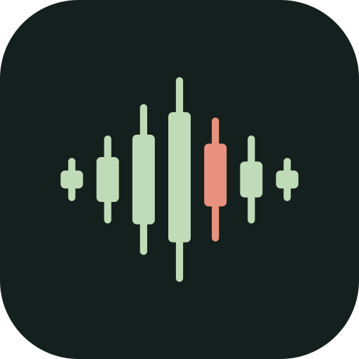

<p align="center">
  
</p>

<h1 align="center">pipsrec</h1>

<p align="center">Your reasoning, remembered.</p>

<p align="center">A local-first desktop recorder for trading sessions, built toward an evidence-backed trading journal.</p>

## Overview

pipsrec preserves the context behind your trading decisions: what was on your chart, what you were thinking, and when it happened. Select the application windows you want to observe, start a session, and review screenshots and notes on a timestamped timeline.

The project is open source under the MIT license and is in early development. The current release is a Windows recording prototype. Voice recording, AI interpretation, and journal composition are planned; they are not available yet.

## Available today

- Select individual application windows to record.
- Start, pause, resume, and stop a session.
- Capture window screenshots manually or on a 15-second schedule.
- Add written notes alongside captured evidence.
- Browse previous sessions and view original screenshots.
- Store evidence locally with SHA-256 hashes and a SQLite timeline.
- Recover interrupted sessions without automatically restarting recording.
- Stop recording from another application with **Ctrl + Shift + F12**.

Window capture uses Windows Graphics Capture. It checks the selected window's handle and process ID before capture and reports unavailable windows in the timeline. TradingView and MetaTrader 5 can be selected like other application windows; neither a broker connection nor a TradingView debugging port is required.

## Getting started

### Requirements

- Windows 10 or 11 with Windows Graphics Capture support.
- Node.js 22 or later and npm.
- Rust with the MSVC toolchain.
- Microsoft C++ Build Tools and Microsoft Edge WebView2.

Follow the [Tauri Windows prerequisites](https://v2.tauri.app/start/prerequisites/#windows) to prepare your development environment. macOS capture is planned and is not implemented in the current prototype.

### Run from source

```powershell
git clone https://github.com/tobbhie/pipsrec.git
cd pipsrec
npm ci
npm run desktop
```

In the application, refresh the window list, select the windows you want to observe, and choose **Start session**. Use **Capture now** for an immediate snapshot. Select a timeline event to inspect its original evidence.

### Build and verify

```powershell
# Type-check and build the interface
npm run build

# Check and test the native application
cargo check --manifest-path src-tauri/Cargo.toml
cargo test --manifest-path src-tauri/Cargo.toml

# Build a desktop executable without an installer
npm run desktop:build
```

`npm run dev` serves an interface preview in a browser. Native recording and storage are available only in the desktop application. `npm run icons` regenerates platform icons from the vector source.

## Privacy and evidence

Recording starts only after you select windows and start a session. The current application makes no cloud AI requests and uploads no recordings. Evidence and notes are stored in the application's local data directory, displayed in the footer.

Original screenshots receive SHA-256 hashes. Timeline events and media metadata are protected against edits through the application's database operations. Interrupted sessions remain stopped when the application restarts, and unlinked files are preserved for recovery.

Local storage is **not encrypted**, and these protections do not prevent someone with filesystem access from changing files. Screenshots may contain account information visible inside an approved window. A process crash during image encoding can also leave an image in the operating system's temporary directory.

The internal application identifier and database filename retain their original names for compatibility with existing prototype sessions. Developers can use `TRADING_MEMORY_DATA_DIR` to select a dedicated absolute data directory.

## Project direction

Upcoming work includes timestamped microphone capture, transcription, chart observations with source citations, reviewable journal drafts, corrections, search, and deterministic performance calculations. AI interpretations will remain distinguishable from original evidence and user-confirmed facts.

The current prototype still needs broader validation across minimized and covered windows, multiple displays, DPI settings, and long recording sessions. The snapshot interval can increase when several windows take longer to capture. There are no packaged releases or automatic updates yet.

## Contributing

Issues and pull requests are welcome. For a bug report, include your Windows version, application version, reproduction steps, and any relevant error message. Use a synthetic example where possible and remove account details from attachments.

Keep changes focused and run the UI build and native tests before opening a pull request. Never include API keys, `.env` files, personal recordings, local databases, or account information in a contribution.

## License

[MIT](LICENSE) © 2026 PipsRec contributors.
